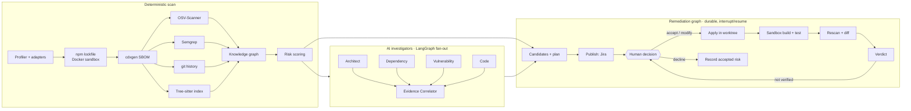

# Guardian

**Repository supply-chain security, from detection to verified remediation, with a human in the loop.**

Guardian scans a repository, prioritises its risks with explainable scores, has AI investigators
explain them, and proposes fixes. Fixes are applied only after a recorded human decision. Guardian
then builds and tests the fix in a sandbox, rescans, and reports a verdict with a tamper-evident
audit trail.

```
Prioritised risk → Recommended fix → Human approval (Jira / local console) → Apply in isolated branch
→ Sandboxed build & test → Rescan → Before/after comparison → Verdict → Report + audit trail
```

## Principles

1. **The scanned repository is hostile.** Its files, git config, advisories and tool output are
   untrusted data and are never executed on the host or treated as instructions.
2. **Deterministic tools establish facts; the LLM interprets.** The AI never decides whether a
   version is vulnerable, never invents a fix version and never approves anything.
3. **The AI chooses only from enumerated candidates and cites evidence.** Output that references
   an unknown candidate, file or finding is rejected.
4. **No change without a recorded human decision.** Changes are made only in a `guardian/fix-*`
   git worktree, never on your working tree, and never pushed.
5. **Unknown stays unknown.** Missing evidence lowers confidence; it is never guessed. AI output
   is always labelled *inference*, separate from *verified* facts.
6. **Everything degrades gracefully.** A missing scanner gives a *partial* scan; no Docker gives an
   `UNVERIFIED` verdict; no API key gives deterministic plans.

## Architecture



| Stage | What happens | Key modules |
|---|---|---|
| Scan | Profile, SBOM, vulnerabilities, code patterns, git changes, source index, knowledge graph | `orchestration/pipeline.py`, `analysis/*`, `indexing/*`, `knowledge/graph_builder.py` |
| Prioritise | R = 0.35 S + 0.25 E + 0.20 X + 0.10 P + 0.10 F → P1–P4 with confidence and per-factor rationale | `knowledge/risk.py` |
| Investigate | Five structured-output agents; every claim must cite input evidence | `investigation/*`, `orchestration/investigation_graph.py` |
| Recommend | Registry-verified upgrade / parent upgrade / override / remove / block / escalate, each with risk reduction, compatibility notes and rollback | `remediation/candidates.py`, `remediation/planner.py` |
| Decide | Jira comment (`/guardian accept`) or local console; strict parser + approver allowlist | `integrations/jira/*`, `ui/*`, `cli/decide.py` |
| Apply · validate · verify | Worktree commit → Docker install/build/test (no network for build/test) → rescan → SBOM and findings diff → `VERIFIED` / `PARTIALLY_VERIFIED` / `FAILED` / `UNVERIFIED` | `remediation/apply.py`, `sandbox.py`, `validate.py`, `verify.py` |
| Orchestrate | One LangGraph thread per case, `SqliteSaver` checkpoints survive restarts | `orchestration/remediation_graph.py`, `remediation/runtime.py` |
| Audit | Append-only, SHA-256 hash-chained event log for every state change | `storage/audit.py` |

## Quick start

Requires Python 3.11+, [uv](https://docs.astral.sh/uv/), and optionally Docker Desktop (sandbox),
`cdxgen`, `osv-scanner` and `semgrep`.

```bash
uv sync
npm install -g @cyclonedx/cdxgen && uv tool install semgrep   # plus osv-scanner (osv.dev)
cp .env.example .env                  # add GUARDIAN_CLI_APPROVERS=<your OS user>; keys optional
uv run guardian doctor                # checks tools, Docker, Jira, LLM keys, checkpoint store
```

**One command** (scan → AI investigators → recommended fixes → review website):

```bash
uv run guardian analyze ~/Documents/juice-shop     # add --no-ai without LLM keys, --rescan to force a scan
```

In the website, open a case and click **Accept**: Guardian applies the fix in a `guardian/fix-*`
worktree, builds and tests it in the Docker sandbox, rescans and shows the verdict. Accept several
cases at once: fixes run in parallel (at most `GUARDIAN_MAX_PARALLEL_FIXES`, default 2, in the
sandbox at a time; git changes to the shared repository are serialised), and each case shows
**Works with the other fixes?**, an in-memory merge of its branch with every other fix branch
that flags conflicts and fixes pinning the same package to different versions.

The same, step by step:

```bash
uv run guardian scan ~/code/juice-shop                       # scan + prioritise (lockfile made in sandbox)
uv run guardian investigate latest --top 5 --max-calls 30    # AI investigators (use --no-ai to skip)
uv run guardian remediate latest --top 5 --min-priority HIGH # cases with recommended fixes
uv run guardian ui                                           # local review console: decide, watch, audit
uv run guardian audit verify                                 # check the audit hash chain
```

See [`docs/demo/day2-runbook.md`](docs/demo/day2-runbook.md) for the full demo script.

## Commands

| Area | Commands |
|---|---|
| One command | `analyze <path\|url>` (scan, investigate, remediate, then open the console) |
| Scan and explore | `scan <path\|url>`, `findings`, `explain <id>`, `deps`, `code`, `graph`, `profile`, `history`, `report` |
| AI | `investigate`, `ai status\|models\|test\|use`, `shell` (interactive, read-only assistant) |
| Remediation | `remediate`, `cases`, `case <id>`, `decide <id> accept\|modify\|decline\|revalidate`, `validate <id>` |
| Human-in-the-loop | `jira push\|sync [--watch]\|status`, `ui` |
| Operations | `audit verify`, `doctor [--online]` |

Jira decisions are comments whose first line starts with `/guardian`:

```text
/guardian accept [candidate=<id>]
/guardian modify version=<x.y.z> | action=<PIN|REMOVE|...> | branch=<ref> | commit=<sha>
/guardian decline reason=false_positive|accepted_risk|wont_fix|duplicate [until=YYYY-MM-DD] -- <why>
/guardian revalidate
```

## Configuration

Settings come from environment variables, `./.env` and `~/.guardian/.env` (git-ignored). Data,
checkpoints, worktrees and logs live in `~/.guardian/`.

| Variable | Purpose |
|---|---|
| `GROQ_API_KEY`, `GOOGLE_API_KEY`, `GUARDIAN_LLM_PROVIDER` | LLM providers (optional) |
| `JIRA_BASE_URL`, `JIRA_EMAIL`, `JIRA_API_TOKEN`, `JIRA_PROJECT_KEY` | Jira Cloud (optional) |
| `GUARDIAN_APPROVERS` / `GUARDIAN_CLI_APPROVERS` | Jira account IDs / local OS users allowed to decide |
| `GUARDIAN_JIRA_MIN_PRIORITY`, `GUARDIAN_JIRA_MAX_ISSUES` | Publishing cap (default HIGH, 5) |
| `GUARDIAN_SANDBOX_CPUS`, `GUARDIAN_SANDBOX_MEMORY`, `GUARDIAN_SANDBOX_TIMEOUT_SECONDS` | Docker limits |
| `GUARDIAN_MAX_PARALLEL_FIXES` | Accepted fixes built/tested/rescanned at once (default 2) |

Secrets are held as `SecretStr`, never logged, stored, sent to the LLM, or passed to any subprocess.

## Security model

- **Tool execution:** one choke point (`execution/runner.py`): allowlisted binaries, no shell,
  scrubbed environment, timeouts, bounded output; git runs with hooks, fsmonitor, external diff,
  pagers and credential helpers disabled.
- **cdxgen** runs in secure mode with `--no-install-deps` under the Node.js permission model
  (flag chosen per Node version). OSV-Scanner sends only package names and versions.
- **Sandbox:** non-root, `--cap-drop ALL`, `no-new-privileges`, read-only root, CPU/memory/pids
  limits, no host env, no Docker socket, a disposable copy instead of a mount of your repo.
  Install scripts are disabled; build and tests run with `--network none`.
- **LLM:** repository and Jira text is wrapped in delimited data blocks, secrets are redacted,
  context is bounded, and outputs are validated against the input's IDs.
- **Console:** binds to 127.0.0.1, per-launch token, Host/Origin checks, strict CSP, text-only
  rendering of untrusted content.

## Project layout

```
src/guardian/
  cli/            Typer commands and the interactive shell
  core/           settings, Pydantic models (scan + remediation), profiler, exceptions
  adapters/       ecosystem detection and manifest edits (Python, Node, Java, containers)
  execution/      hardened tool runner and execution policies
  analysis/       cdxgen, CycloneDX, OSV-Scanner (+ affected ranges), Semgrep, git analysis
  indexing/       Tree-sitter symbols, imports, calls, entry points, code retrieval
  knowledge/      knowledge graph, graph queries, risk scoring
  investigation/  AI investigator schemas, prompts, evidence validation, budgeted runner
  remediation/    candidates, npm semver/registry, planner, cases, apply, sandbox, validate, verify, runtime
  orchestration/  scan pipeline, investigation graph, remediation graph, checkpoints
  integrations/   Jira client, ADF, publishing, command parser, sync, write-back
  llm/            Groq / Gemini providers and model catalog
  assistant/      read-only tool-calling assistant for the shell
  storage/        SQLite stores and migrations 001–006 (scans, findings, cases, audit, investigations)
  reporting/      HTML / Markdown / JSON reports and graph export
  ui/             local review console (stdlib HTTP server + static app)
  sources/        safe cloning of remote repositories
docker/           dependency-image Dockerfile for the sandbox
docs/decisions/   architecture decision records (01–11)
docs/demo/        demo runbook
tests/            unit, integration and e2e tests (Jira and LLM calls are mocked)
```

## Development

```bash
uv run pytest                     # tests + coverage gate (80%)
uv run ruff check src tests && uv run ruff format src tests
uv run ty check src
```

Design rationale and trade-offs are recorded in [`docs/decisions/`](docs/decisions/README.md);
[ADR 11](docs/decisions/11-human-approved-remediation.md) covers human-approved remediation.
